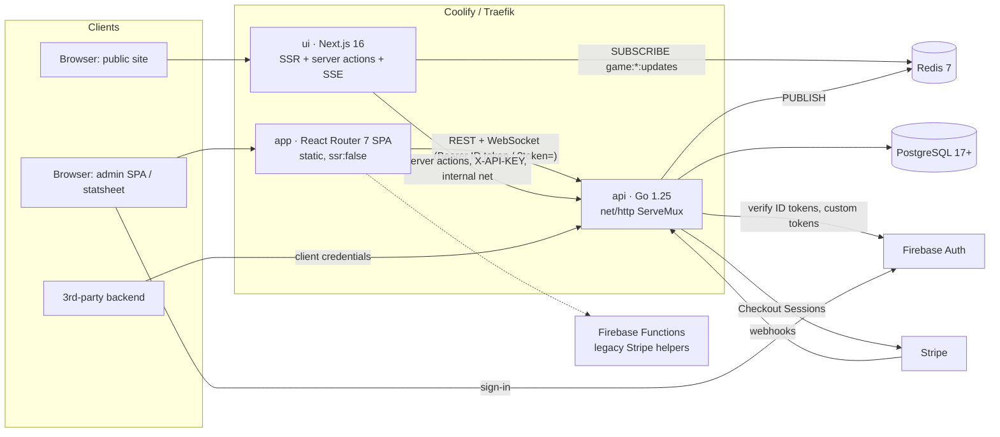
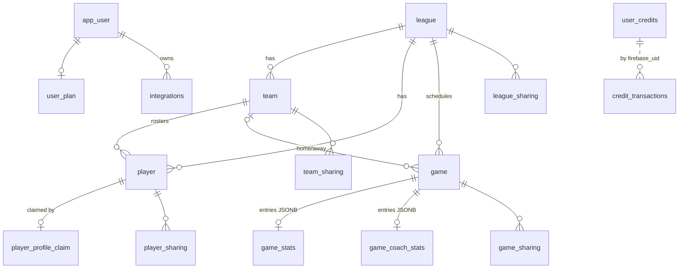

# Technical Specification — Jump Stop Pivot

> **Status:** as built on 2026-10-29. Companion docs: [functional-spec.md](functional-spec.md),
> [business-rules.md](business-rules.md), [open-issues.md](open-issues.md).
> Deep dives that remain authoritative: [DOCKER.md](../../DOCKER.md), [REALTIME_TRANSPORT.md](../../REALTIME_TRANSPORT.md),
> [app/STATSHEET_SYNC.md](../../app/STATSHEET_SYNC.md), [api/docs/](../../api/docs/) (Swagger, ERD, DBML).

## 1. System architecture



| Component | Hosting | Notes |
|---|---|---|
| `api` | Coolify container (`api.Dockerfile`, multi-arch) | Single instance assumed (in-memory WS hub, see OI-TECH-04) |
| `ui` | Coolify container (`ui.Dockerfile`) | Calls the API over the internal Docker network `http://api:8080` |
| `app` | Static build (Firebase Hosting in prod; `app.localhost` locally) | Calls the API from the browser |
| PostgreSQL | Coolify | `uuidv7()` defaults require PG ≥ 17. Compose uses `postgres:18-alpine` |
| Redis | Coolify | Optional. If `REDIS_URL` is unset the API skips publishing and the SSE endpoints receive no live updates |

Local environment: `docker compose up`, with Traefik doing host-based routing (`localhost`, `app.localhost`, `api.localhost`). See [DOCKER.md](../../DOCKER.md).

## 2. Backend (`api/`)

### 2.1 Layout
Follows the standard Go service layout: `cmd/`, `internal/<domain>/`, `pkg/`, `migrations/`, `docs/`, `scripts/`.

| Path | Purpose |
|---|---|
| `cmd/api/` | `main.go` (bootstrap, shutdown), `init_modules.go` (DI per domain), `init_services.go` (workers, migrations, route collection) |
| `cmd/apikeys/` | CLI for API key generation |
| `internal/league/` | Leagues, teams, players, games, game stats, WebSocket, standings, metrics, score/player workers. Files follow `<entity>_<layer>.go`. Public read handlers are in `*_handler_public.go` |
| `internal/user/` | App user, plans, plan-activity worker |
| `internal/credits/` | Balance, transactions, Stripe checkout and webhook |
| `internal/integrations/` | M2M integrations (files named `handler/service/store/model.go` without the domain prefix) |
| `internal/coffee/` | Donation checkout (no store) |
| `pkg/auth`, `pkg/middleware` | Identity resolution, middleware chain |
| `pkg/sharetoken` | Share-link JWTs |
| `pkg/firebase` | Admin SDK wrapper: lookups, custom tokens, token exchange and refresh |
| `pkg/postgres` | pgx pool, migration runner |
| `pkg/redis` | Pub/sub publisher |
| `pkg/config` | Env loading |
| `pkg/caching`, `pkg/r2`, `pkg/resend`, `pkg/httpclient`, `pkg/apikey` | Infrastructure. `caching`, `r2` and `resend` are **not yet used** by any domain |

### 2.2 Layering
`handler → service → store`. The league module groups its services and stores in aggregates (`league.Service{League, Team, Player, Game, GameStats}`, `league.Store{…, Metrics}`), wired in [init_modules.go](../../api/cmd/api/init_modules.go).
- **Handlers** parse the request and the identity from context, call the service, and map errors to HTTP. All responses are JSON with the envelope `{error: bool, message: string, …}`.
- **Services** validate input, apply defaults, check roles and credits, and publish events.
- **Stores** run SQL with pgx named args. Several role checks live **in SQL** (`EXISTS (SELECT 1 FROM *_sharing WHERE … role IN (…))`). Multi-step writes use transactions with retry on serialization or deadlock errors (`isRetryableErr`, 3 attempts, linear backoff of 50 ms × attempt).

Cross-domain dependencies are expressed as small interfaces: `creditsChecker` (league → credits), `LeagueServiceInterface` (user → league), and `AppUserProvisioner` (integrations → user, through an adapter in `init_modules.go`).

### 2.3 Request pipeline
```
PanicRecovery → IPBlocker(BLOCKED_IPS) → UserAgentBlocker(BLOCKED_USER_AGENTS)
→ RouteValidator(registered routes; unknown → 404) → CORS(allowed origins)
→ RateLimiter(1 rps, burst 50 per IP) → LogRequests
→ FirebaseAuth (share token | ID token | public user) → ApiKeyAuth(TEMP_API_KEY, optional)
→ ServeMux handler
```
Server timeouts are read/write 15 s and idle 60 s. pprof is exposed at `/debug/pprof/*` when `GO_ENV=development` or `ENABLE_PPROF=true`.

### 2.4 Authentication & identity
| Mechanism | Carrier | Resolves to | Used by |
|---|---|---|---|
| Firebase ID token | `Authorization: Bearer` (fallback `?auth=`) | `User{UserID=uid}` | Admin SPA, integrations |
| Integration token | Firebase ID token for UID `integration:<uuid>` with claims `integration`, `integrationId`, `scopes` | `User{IsIntegration=true}` | Third parties |
| Share token | `?token=` HS256 JWT `{entityId, entityType, role}` | `User{ShareTokenUser=true, EntityID, GrantedRole}` | Guest scorers |
| API key | `X-API-KEY` = `TEMP_API_KEY` | (no identity) | Next.js server actions |
| None | — | `User{UserID="public-user", PublicUser=true}` | Public reads |

Authorization is per entity and role-based (`owner` / `editor` / `viewer`) through the `*_sharing` tables. See BR-ROLE-* and the security gaps in OI-SEC-01..06.

### 2.5 API surface (summary)
The full contract is in [api/docs/swagger.yaml](../../api/docs/swagger.yaml) (regenerate with `scripts/generate-swagger.sh`). All paths are prefixed with `/v1`.

| Area | Endpoints |
|---|---|
| Health | `GET /v1/healthcheck`, `GET /api/healthcheck`, `GET /robots.txt` |
| Leagues | `GET /leagues` (mine), `/leagues/all`, `/leagues/active`, `/leagues/search`, `/leagues/{id}`. `POST/PUT/DELETE /leagues[/{id}]`. `GET /leagues/{id}/teams\|players\|stat-leaders\|games\|standings`. `POST /leagues/{id}/players/import`. `GET/POST/DELETE /leagues/{id}/sharing[/{uid}]`. `POST /leagues/quick-game` |
| Teams | `GET /teams` (mine), `/teams/all`, `/teams/active`, `/teams/search`, `/teams/{id}`, `/teams/{teamId}/players`. CRUD. Sharing |
| Players | `GET /players` (mine), `/players/all`, `/players/active`, `/players/search`, `/players/{id}`, `/players/{id}/games`. CRUD. Sharing. `GET/POST/DELETE /players/{id}/claim` |
| Games | `GET /games/all`, `/games/active`, `/games/stats-enabled`, `/games/user`, `/games/search`, `/games/{id}`. CRUD. Sharing. `POST /games/{id}/share-link` |
| Game stats | `GET/PUT/PATCH/DELETE /games/{id}/stats`, `GET/PUT/PATCH/DELETE /games/{id}/coach-bench-stats`, `GET /games/{id}/players`, **`GET /games/{id}/stats/ws`** (WebSocket) |
| Users & plans | `GET/POST /users/me`, `GET /users/me/plan`, `POST /users/plan`, `PUT/DELETE /users/plan/{id}` |
| Credits | `GET /credits`, `/credits/balance`, `/credits/transactions`, `/credits/packages`. `POST /credits/checkout`, `POST /credits/webhook` |
| Integrations | `POST/GET /integrations`, `DELETE /integrations/{id}`, `POST /integrations/token`, `/integrations/token/refresh`, `/integrations/users/provision` |
| Coffee | `GET /coffee/tiers`, `POST /coffee/checkout`, `POST /coffee/webhook` |
| Metrics | `GET /metrics` (platform counts) |

List endpoints paginate with `page` and `pageSize` and return `{limit, page, skip, totalPages, totalResults, nextPage}`.

### 2.6 Data model
Authoritative diagrams: [api/docs/ERD.md](../../api/docs/ERD.md), [schema.dbml](../../api/docs/schema.dbml). Source of truth: [api/migrations/](../../api/migrations/).



Key design choices:
- **Identity key is `firebase_uid` (TEXT)** everywhere, not `app_user.id`. Only `user_plan` and `integrations` have foreign keys to `app_user`.
- **Stats as JSONB snapshots:** one `game_stats` row per game, holding an array of per-player entries (GIN-indexed). Merges lock the row. Score and average roll-ups run in SQL over `jsonb_array_elements`.
- **Denormalised player averages** on `player` (`*_per_game`, `games_played`) are refreshed by a worker.
- **UUIDv7 PKs** (`uuidv7()` built-in, migration 5) give time-ordered IDs.
- **Cascades:** league deletion cascades to everything. Team deletion nulls player and game references.

### 2.7 Migrations
- On startup `RunMigrations` checks whether **all** 16 expected tables exist. If any is missing it executes the single file in `MIGRATION_FILE_PATH` (default `1_create_tables.up.sql`, which is idempotent through `IF NOT EXISTS`).
- Migrations 2–5 are **manual** scripts to run by hand against existing databases. There is no version table (OI-TECH-03).

### 2.8 Background workers
Started in `startBackgroundWorkers`, they run in-process and stop on context cancel. Each runs once at start, then on a ticker.

| Worker | Interval | Work |
|---|---|---|
| `ScoreWorker` | 1 min | `UpdateScoresFromStats` derives game scores from stat entries (BR-GAME-003) |
| `PlayerStatsWorker` | 60 min | `UpdatePlayerAverages` recomputes per-game averages (BR-STAND-002) |
| `PlanActivityWorker` | 8 h | Activates or deactivates plans by date window (BR-PLAN-001) |

With multiple API replicas, each replica runs every worker. The SQL is idempotent, so this is safe but redundant.

### 2.9 Real-time
Two independent paths:

**A. Recorders: WebSocket (bidirectional), `GET /v1/games/{id}/stats/ws`**
- Auth uses the Bearer/`?auth=` ID token or `?token=` share token. Access is checked before the upgrade.
- An in-memory `gameStatsHub` holds rooms keyed by game ID. On connect the server sends the current `stats_updated` and `coach_bench_stats_updated` snapshots.
- Client → server: `upsert_stats`, `merge_stats`, `upsert_coach_bench_stats`, `merge_coach_bench_stats`.
- Server → client: `stats_ack` / `coach_bench_stats_ack` (to the sender), `stats_updated` / `coach_bench_stats_updated` (broadcast to the room), and `error`.
- Heartbeat: ping every 30 s, with a 10 s pong timeout.
- The ack/echo is the client's commit confirmation. See [REALTIME_TRANSPORT.md](../../REALTIME_TRANSPORT.md).

**B. Spectators: Redis → SSE (one-way)**
- After every successful stats write, the service publishes the full entry list to Redis channel `game:{id}:updates` (or `game:{id}:coach-updates`).
- Next.js route handlers `ui/app/api/games/[id]/stream` and `…/coach-stream` subscribe and forward as `text/event-stream`. They send an initial snapshot on connect.

```mermaid
sequenceDiagram
  participant R as Recorder (SPA)
  participant API as Go API
  participant DB as Postgres
  participant Redis
  participant UI as Next.js SSE
  participant F as Fan browser
  R->>API: WS merge_stats {deltas}
  API->>DB: BEGIN; SELECT … FOR UPDATE; apply deltas; UPDATE; COMMIT
  API-->>R: stats_ack
  API-->>R: stats_updated (room broadcast)
  API->>Redis: PUBLISH game:{id}:updates
  Redis-->>UI: message
  UI-->>F: data: {entries}
```

### 2.10 Client-side sync (statsheet)
Implemented in [useStatSheetSync.ts](../../app/lib/hooks/useStatSheetSync.ts), [useGameStatsSocket.ts](../../app/lib/hooks/useGameStatsSocket.ts) and [statTransaction.ts](../../app/lib/statTransaction.ts), with state in a reducer in [statsheet.context.tsx](../../app/app/context/statsheet.context.tsx).
- **Local-first:** taps mutate reducer state immediately and set `dirty`.
- **Pending record:** `stat-pending-{gameId}` in localStorage exists exactly while there are unconfirmed changes. It is re-sent on reload or reconnect and expires after 24 h.
- **Deltas against a baseline:** `lastAckedEntriesRef` holds the last server-confirmed state, and the client sends `current − lastAcked`. The server adds deltas, so concurrent recorders compose.
- **Dirty-guard rebase:** an incoming remote snapshot is rebased under local unconfirmed changes instead of replacing them.
- **Timing:** player stats are debounced 2 s and bench stats 800 ms.

### 2.11 Payments
- **Credits:** the API creates a Stripe Checkout Session over raw HTTPS (no SDK) and verifies the webhook with a hand-rolled HMAC check (5-minute tolerance). Credits are added in one transaction together with a ledger row.
- **Coffee:** the same pattern, with fixed tiers and no ledger.
- Both webhooks share `STRIPE_WEBHOOK_SECRET`, so a single Stripe endpoint secret has to be valid for both URLs.
- **Legacy:** Firebase Functions (`app/functions/src/index.ts`, region `australia-southeast1`) provide `getStripePrice`, `ensureStripeCustomer`, `getLeaguePurchaseCount` and `useLeagueCredit` backed by Firestore `customers/{uid}`, plus an `auth.user().onCreate` trigger. See OI-TECH-06.

## 3. Admin SPA (`app/`)
- React 19, React Router 7.12 (framework mode, `ssr: false`, file-based route config in [app/app/routes.ts](../../app/app/routes.ts)), Vite 7, Tailwind 4, Firebase JS SDK 12.
- Structure: `app/app/routes/*` (pages), `actions/*.actions.ts` (API calls), `context/` (user, league, statsheet), `components/`, `types/`. Shared infrastructure is in `app/lib/` (`fetch/fetchClient.ts`, `firebase/*`, `hooks/*`).
- Routes are grouped as public auth pages, `auth.guard.tsx` (protected), and `stats.layout.tsx` (the statsheet with minimal chrome).
- This does not match the standard domain-folder layout. See OI-TECH-07.

## 4. Public site (`ui/`)
- Next.js 16 (App Router), React 19, Tailwind 4, ioredis.
- Pages are server components that fetch through **server actions** in `ui/actions/*.actions.ts`, which call the API at `http://api:8080` with `X-API-KEY`.
- Route handlers in `ui/app/api/` cover SSE streams, OG/hero/game/team/player image generation (`opengraph-image.tsx` per entity), and the coffee checkout proxy.
- SEO: `sitemap.ts`, `robots.ts`, per-entity OG images. `ui/lib/rate-limit.ts` defines in-memory limiters (images: 20/min, other API routes: 60/min).
- `AutoRefresh` component and SSE give live pages.

## 5. Configuration
API env vars (from [pkg/config/config.go](../../api/pkg/config/config.go)):

| Var | Purpose |
|---|---|
| `GO_ENV`, `GO_LOG`, `PORT` | Environment, log level, port (default 8080) |
| `DATABASE_URL`, `MIGRATION_FILE_PATH` | Postgres, bootstrap migration file |
| `FIREBASE_CERT`, `FIREBASE_DB_URL`, `FIREBASE_WEB_API_KEY` | Admin SDK, plus the web API key for token exchange and refresh |
| `GO_CORS_ALLOWED_ORIGIN_ADDON`, `GO_CORS_DEBUG` | Extra CORS origins, debug logging |
| `BLOCKED_IPS`, `BLOCKED_USER_AGENTS` | Comma-separated blocklists |
| `SHARE_TOKEN_SECRET`, `SHARE_TOKEN_EXPIRY_HOURS` | Share-link JWTs (default 4 h) |
| `TEMP_API_KEY` | Server-to-server key for `ui` |
| `STRIPE_SECRET_KEY`, `STRIPE_WEBHOOK_SECRET` | Payments |
| `REDIS_URL` | Optional pub/sub |
| `R2_*`, `RESEND_*`, `PUBLIC_SIGNUP_URL` | Loaded but unused by domains today |
| `ENABLE_PPROF` | Profiling |
| `RACE_EXTERNAL_API_URL`, `PAYLOAD_EXTERNAL_API_KEY` | Leftovers from another project (OI-TECH-01) |

## 6. Quality & operations
- **Tests:** Go has tests in `pkg/` only (`httpclient`, `r2`, `auth`) and none in `internal/` (OI-TECH-05). Front-end test coverage has not been assessed in this pass. `scripts/test-report.sh` exists.
- **Logging:** `slog` with a pretty handler in dev (`pkg/prettylog`). Every request is logged.
- **Docs generation:** `scripts/generate-swagger.sh`, `generate-open-api.sh` and `generate-erd.sh` (ERD from the migrations).
- **Graceful shutdown:** on SIGINT/SIGTERM the root context is cancelled, which stops the workers, and `http.Server.Shutdown` runs. Hijacked WebSocket connections are not tracked by `Shutdown`, so they drop when the process exits.
